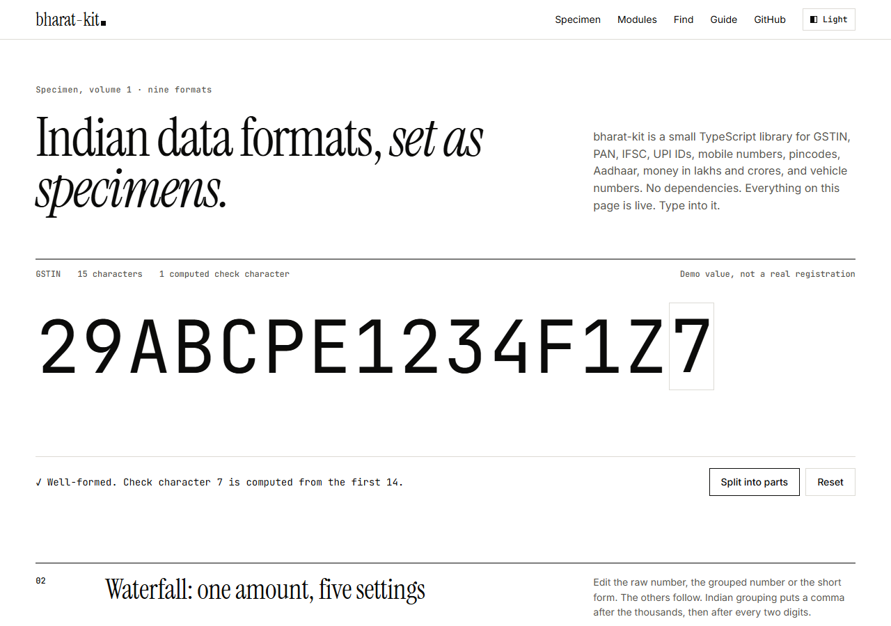
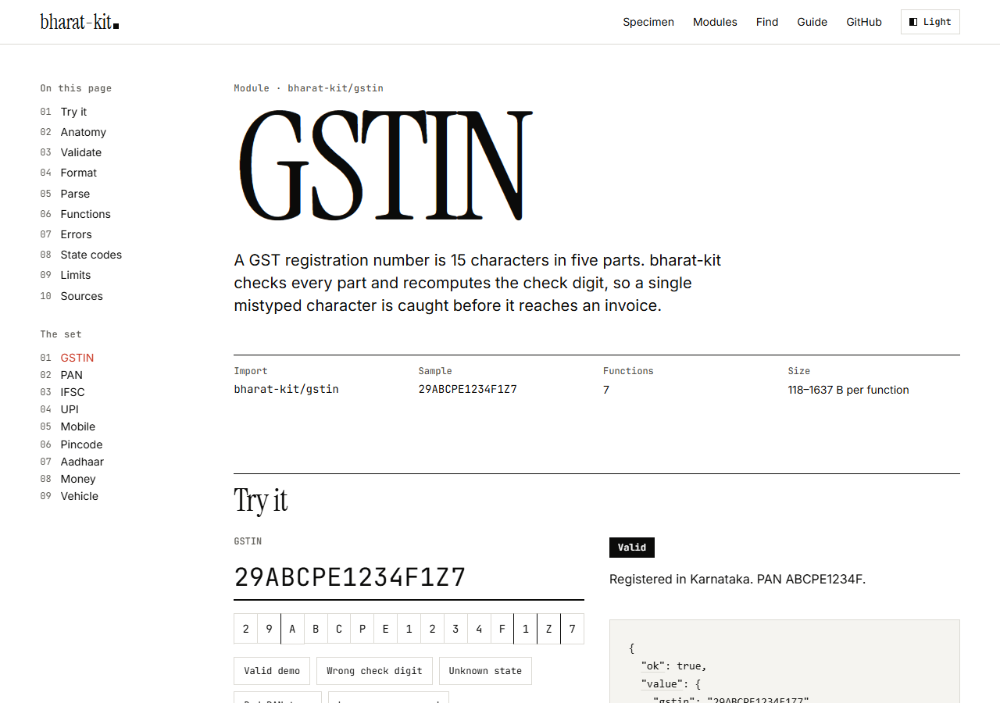
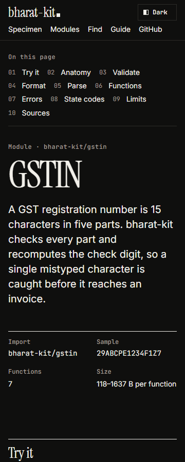
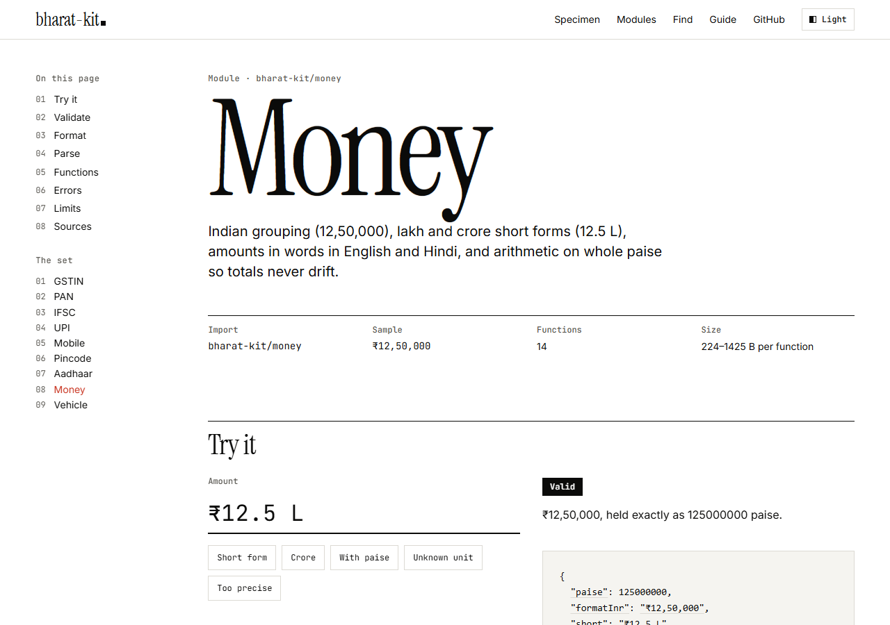
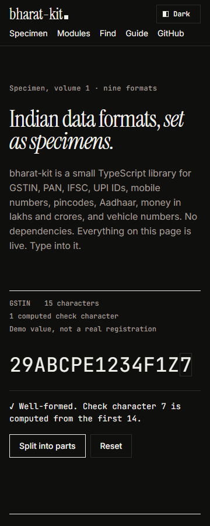
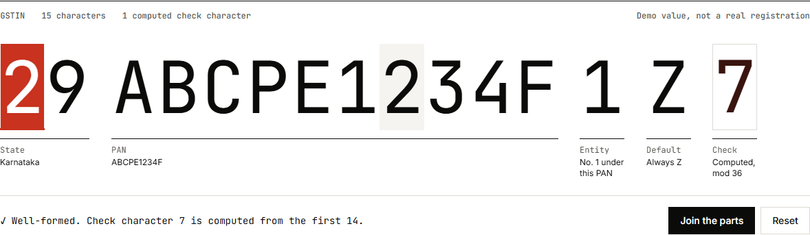
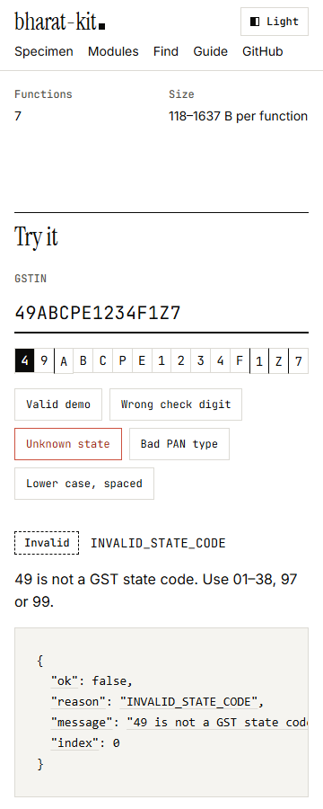
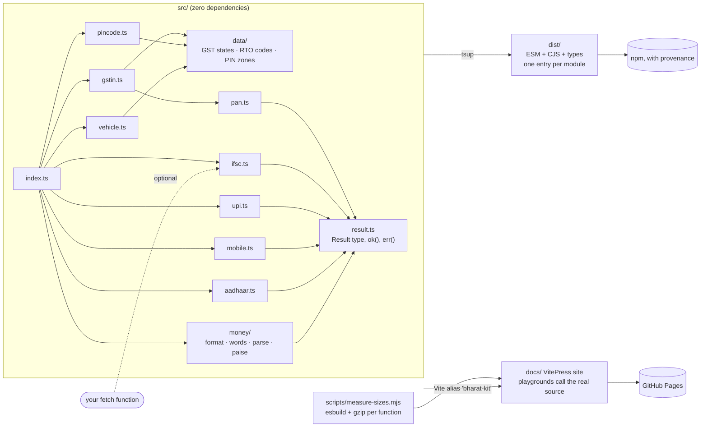

# bharat-kit

Validate, parse and format Indian data in TypeScript: GSTIN, PAN, IFSC, UPI IDs, mobile numbers, pincodes, Aadhaar checksums, money in lakhs and crores, and vehicle numbers. Zero dependencies, with clear error reasons rather than just `true` or `false`.

[](https://github.com/Devkeerthi-code/bharat-kit/actions/workflows/ci.yml)
[](https://www.npmjs.com/package/bharat-kit)
[](https://bundlejs.com/?q=bharat-kit)
[](https://www.npmjs.com/package/bharat-kit)
[](./LICENSE)

**Live docs and playground:** TODO: add the link after the first GitHub Pages deploy (expected at `https://devkeerthi-code.github.io/bharat-kit/`).



## Who is this for and what problem does it solve?

It's for developers building Indian apps: billing tools for small shops, college fee portals, KYC forms, delivery apps, invoice generators.

These apps all check the same handful of identifiers and format money the Indian way. In practice every project copies a regex from a forum. The regex usually misses the GSTIN check digit, accepts a PAN with an impossible holder type, treats `+91 98765-43210` as invalid, and formats ₹12,50,000 as "1,250,000". Then the next project writes the same helpers again.

bharat-kit puts those helpers in one small, typed, tested package:
- **Real algorithms.** It recomputes the GSTIN mod-36 check digit and the Aadhaar Verhoeff checksum rather than only matching a pattern.
- **Reasons, not booleans.** A failure carries a stable code (`INVALID_CHECK_DIGIT`), a message you can show to a user, and the position of the bad character.
- **Cited sources.** Every rule links to its official or well-documented source (see [Sources](#sources)).
- **Small imports.** Each module is its own entry point, so you ship only what you import. `isValidGstin` alone costs about 1.3 kB.

## Screenshots

| Desktop (light) | Phone (dark) |
| --- | --- |
|  |  |
|  |  |

| GSTIN split into its parts | Playground with an exact error reason |
| --- | --- |
|  |  |

## Install

```sh
npm i bharat-kit
```

It runs in browsers, Node 18+, Deno, Bun and edge runtimes. It ships ESM and CommonJS builds with type definitions.

## Quick examples

```ts
import { validateGstin, parseGstin } from "bharat-kit/gstin";

validateGstin("29ABCPE1234F1Z8");
// { ok: false, reason: "INVALID_CHECK_DIGIT", message: "The check digit should be 7, not 8.", index: 14 }

parseGstin("29abcpe1234f1z7");
// { ok: true, value: { stateCode: "29", stateName: "Karnataka", pan: "ABCPE1234F", panHolderType: "P", … } }
```

```ts
import { formatInr, toShortForm, toWords, rupeesInWords, percentOfPaise } from "bharat-kit/money";

formatInr(1250000);           // "₹12,50,000"
toShortForm(34000000);        // "3.4 Cr"
toWords(1250000, "hi");       // "बारह लाख पचास हज़ार"
rupeesInWords(125050);        // "One thousand two hundred fifty rupees and fifty paise only"
percentOfPaise(99900, 18);    // 17982: 18% GST on ₹999, exact, in paise
```

```ts
import { validateMobile, toWhatsAppLink } from "bharat-kit/mobile";
import { buildUpiLink } from "bharat-kit/upi";
import { maskAadhaar } from "bharat-kit/aadhaar";

validateMobile("+91 98765-43210");           // { ok: true, value: "9876543210" }
toWhatsAppLink("098765 43210", "Order ready?"); // { ok: true, value: "https://wa.me/919876543210?text=Order%20ready%3F" }
buildUpiLink({ payeeVpa: "demo.shop@okbank", payeeName: "Demo Shop", amountPaise: 12550 });
// { ok: true, value: "upi://pay?pa=demo.shop@okbank&pn=Demo%20Shop&am=125.50&cu=INR" }
maskAadhaar("2345 6789 0124");               // { ok: true, value: "XXXX XXXX 0124" }
```

Every value in this README is invented demo data. `2345 6789 0124` is a made-up number that happens to pass the checksum.

## Modules

| Module | Import | What it does | Main functions | Size per function* |
| --- | --- | --- | --- | --- |
| GSTIN | `bharat-kit/gstin` | Format, state code, embedded PAN, entity number, mod-36 check digit | `validateGstin`, `parseGstin`, `formatGstin`, `gstinCheckDigit` | 118–1,637 B |
| PAN | `bharat-kit/pan` | Format and holder type from the 4th letter | `validatePan`, `parsePan` | 116–786 B |
| IFSC | `bharat-kit/ifsc` | Offline format and bank/branch split; optional lookup through your own fetcher | `validateIfsc`, `parseIfsc`, `lookupIfsc` | 117–863 B |
| UPI | `bharat-kit/upi` | VPA validation and `upi://pay` links with correct encoding | `validateVpa`, `parseVpa`, `buildUpiLink` | 91–1,068 B |
| Mobile | `bharat-kit/mobile` | Normalise +91 / 0 / spaces, validate, format, `wa.me` links | `validateMobile`, `formatMobile`, `toWhatsAppLink` | 174–587 B |
| Pincode | `bharat-kit/pincode` | Format, postal zone, sub-zone circle, sorting district | `validatePincode`, `parsePincode` | 96–988 B |
| Aadhaar | `bharat-kit/aadhaar` | Format and Verhoeff checksum only, plus masking | `validateAadhaar`, `maskAadhaar`, `verhoeffValidate` | 96–619 B |
| Money | `bharat-kit/money` | 12,50,000 grouping, L/Cr short forms, words in English and Hindi, paise arithmetic | `formatInr`, `toShortForm`, `toWords`, `rupeesInWords`, `parseAmount`, `percentOfPaise`, `splitPaise` | 224–1,425 B |
| Vehicle | `bharat-kit/vehicle` | State plates and Bharat (BH) series; state from the code | `parseVehicleNumber`, `formatVehicleNumber` | 126–1,168 B |

\* Minified and gzipped, measured by importing each function alone (`npm run docs:sizes`). The full docs list every function with its signature, return type, errors and exact size.

### The Result type

```ts
type Result<T, R extends string> =
  | { ok: true; value: T }
  | { ok: false; reason: R; message: string; index?: number };
```

`reason` is a stable union of string literals, so TypeScript can check a `switch` over it. `message` is plain English for a user. `index` points at the offending character where there is one. Each module also has an `isValid…` function that returns a boolean.

## Aadhaar and privacy

An Aadhaar number is sensitive personal data. The Aadhaar Act and UIDAI's rules restrict who may collect it and require it to be stored securely. Usually the right answer is not to store it at all.

- The Aadhaar module only checks the format and the Verhoeff checksum, and masks. It cannot tell whether a number was issued, and nothing should be built on that assumption.
- The functions are pure. They keep nothing, make no network calls, and never write to the console. `no-console` is a lint error in this repository.
- Error messages never contain the input or any part of it. A property-based test checks this against random numbers.
- `maskAadhaar` works on any 12-digit input, so you can mask straight away and keep only `XXXX XXXX 1234`.

## Tech stack

- **Library:** TypeScript (strict, `noUncheckedIndexedAccess`, `exactOptionalPropertyTypes`), zero runtime dependencies.
- **Build:** tsup. ESM and CJS outputs, `.d.ts` and `.d.cts` types, one entry per module, `sideEffects: false`.
- **Tests:** Vitest with V8 coverage (100% lines, branches, functions and statements are enforced) and fast-check for property-based tests.
- **Quality:**
  - ESLint with typescript-eslint (strict).
  - size-limit budgets per entry point.
  - publint for the package layout.
  - A smoke test of the built package on Node 18.
- **Release:** Changesets and GitHub Actions. npm publish with provenance.
- **Docs:** VitePress with a fully custom theme (Vue 3), deployed to GitHub Pages. Fonts: Instrument Serif, Inter, JetBrains Mono and Noto Serif Devanagari.

## Architecture



The docs site imports the library source directly through a Vite alias. The playgrounds and specimens can't drift from the published behaviour: if a function changes, the docs change with it. The spec tables' byte sizes are measured at docs build time, not typed by hand.

## Design decisions

1. **Return a `Result`, don't throw, for user input.**
   - *Alternatives:* booleans, or exceptions.
   - *Why:* booleans can't say what's wrong, and exceptions make validation in a form handler awkward and easy to forget. A `Result` with a literal-union `reason` lets TypeScript check every case.
   - *Trade-off:* slightly more verbose call sites, which is why each module also has `isValid…`.
   - *Exception:* the paise arithmetic helpers throw `RangeError`. A fractional paisa is a bug in the calling code, not bad user input.
2. **Money as integer paise.**
   - *Alternatives:* floats, or a decimal library.
   - *Why:* floats drift (`0.1 + 0.2`), and a decimal library would break the zero-dependency rule. Integers are exact up to about ₹90 lakh crore, which covers real invoices.
   - *Precision:* `percentOfPaise` uses BigInt internally, so percentages with two decimals are exact. `allocatePaise` hands out leftover paise by largest remainder, so the split always sums to the total.
3. **No network calls in the core; the IFSC lookup takes your fetcher.**
   - *Alternatives:* bundle a bank directory (megabytes, stale within weeks), or hard-code one API (a vendor dependency and a privacy concern).
   - *Why:* passing in `(code, signal) => Promise<T | null>` keeps the library pure and testable.
   - *What the library adds:* it validates first, so a malformed code never makes a request, and it handles timeout and cancellation for you.
4. **Small data tables instead of complete directories.**
   - *What ships:* GST state codes, RTO state codes, PIN zones and circle ranges, all a few hundred bytes.
   - *What doesn't:* bank names, post-office lists and RTO office lists. Those change often and would multiply the bundle size.
   - *Trade-off:* a valid pincode may not exist. The docs say so for every module.
5. **One entry point per module plus `sideEffects: false`.**
   - *Alternative:* a single entry with tree-shaking.
   - *Why:* tree-shaking alone works with modern bundlers, but subpath imports also help older tooling and make the cost of each import visible.
   - *Enforcement:* size-limit fails CI if any entry grows past its budget.

## How to run locally

```sh
npm install
npm test            # unit and property-based tests
npm run coverage    # tests with the 100% coverage gate
npm run ci          # lint, typecheck, coverage, build, smoke test, size, publint
npm run docs:dev    # docs site at http://localhost:5173/bharat-kit/
```

The library needs no environment variables. The docs build reads two optional ones, explained in [.env.example](./.env.example).

## Deploy

**Docs (GitHub Pages)**
1. Push the repository to GitHub with `main` as the default branch.
2. In the repository settings, open **Pages** and set **Source** to **GitHub Actions**.
3. The `Docs` workflow builds `docs/` and deploys it on every push to `main`. The site is served from `https://<user>.github.io/bharat-kit/`. If you use a custom domain, set `DOCS_BASE=/` for the build.
4. Optional: add a repository variable `GOATCOUNTER_CODE` to count page views without cookies.

**npm**
1. Create an npm account and choose one way to authenticate:
   - Configure trusted publishing for this repository on npmjs.com.
   - Or add an automation token as the repository secret `NPM_TOKEN`.
2. On a push to `main` with pending changesets, the `Release` workflow opens a "Version Packages" pull request.
3. Merging that pull request publishes the new version to npm with provenance.

## Contributing

1. Fork, then run `npm install`.
2. Make the change with tests. Coverage must stay at 100%, and a new algorithm needs a property-based test and a cited source.
3. Run `npm run ci`.
4. Run `npx changeset` and describe the change for users.
5. Open a pull request.

Use only invented demo values in tests, docs and issues. Never paste a real Aadhaar, PAN or GSTIN.

## Sources

| Rule | Source |
| --- | --- |
| GSTIN format and state codes | [GST portal](https://www.gst.gov.in/). The check digit is the [Luhn mod N](https://en.wikipedia.org/wiki/Luhn_mod_N_algorithm) algorithm with N = 36, verified against the published sample `27AAPFU0939F1ZV` |
| PAN structure and holder types | [Income Tax Department: Permanent Account Number](https://www.incometaxindia.gov.in/documents/d/guest/1-permanent-account-number-pan-pdf) |
| IFSC structure (5th character is 0) | [RBI: NEFT FAQs](https://www.rbi.org.in/commonman/english/scripts/FAQs.aspx?Id=274) |
| `upi://pay` parameters | NPCI UPI Linking Specifications 1.6 ([copy](https://www.labnol.org/files/linking.pdf)), [NPCI UPI](https://www.npci.org.in/product/upi) |
| Mobile numbers start with 6–9 | [DoT: National Numbering Plan](https://dot.gov.in/national-numbering-plan) |
| `wa.me` click-to-chat links | [WhatsApp Help Center](https://faq.whatsapp.com/5913398998672934) |
| PIN zones and sub-zones | [India Post](https://www.indiapost.gov.in/), [Postal Index Number](https://en.wikipedia.org/wiki/Postal_Index_Number) |
| Aadhaar: 12 digits, Verhoeff check digit | [Verhoeff algorithm](https://en.wikipedia.org/wiki/Verhoeff_algorithm) (tables and the 236 → 3 worked example), [Aadhaar](https://en.wikipedia.org/wiki/Aadhaar), [UIDAI](https://uidai.gov.in/) |
| Lakh and crore grouping | [Indian numbering system](https://en.wikipedia.org/wiki/Indian_numbering_system) |
| Hindi number names 1–99 | [Hindustani numerals](https://en.wikipedia.org/wiki/Hindustani_numerals) |
| Vehicle state codes | [Vehicle registration plates of India](https://en.wikipedia.org/wiki/Vehicle_registration_plates_of_India) |
| BH series `YY BH #### XX` | [PIB: Bharat series, G.S.R. 594(E)](https://www.pib.gov.in/PressReleasePage.aspx?PRID=1883991) |

## Limitations and what breaks at scale

- **Format, not existence.** A valid GSTIN, PAN, IFSC, UPI ID, pincode or vehicle number is well-formed, not necessarily registered or active. Confirming that needs the issuing authority's API.
- **Special registrations are rejected.** The GSTIN module accepts regular taxpayers only. TDS/TCS, UIN and non-resident registrations use other patterns.
- **The PAN check character isn't verified.** Its algorithm is not public.
- **Landlines can pass as mobiles.** A landline written with its STD code (`080 2345 6789`) is indistinguishable from a mobile number once the trunk 0 is removed.
- **Pincode circles are hints.** A few border areas are served by a neighbouring state's circle.
- **Large amounts.** Words and paise arithmetic stop at `Number.MAX_SAFE_INTEGER` paise (about ₹90 lakh crore). Larger amounts need a BigInt-based API, which doesn't exist yet.
- **Stale tables.** State codes change rarely, but they do change (DD and DN merged in 2020, TS became TG in 2024). Each change needs a release, and apps on old versions keep the old list.
- **At scale:**
  - Everything is pure and synchronous except `lookupIfsc`, so throughput is limited only by your own servers.
  - What breaks is the lookup. A busy app calling a public IFSC API on every keystroke will hit rate limits. Cache lookups by code (IFSCs rarely change) and only call on submit.

## What I learned

- **Property-based tests find real bugs.** A fast-check property caught a mistyped row in my Verhoeff permutation table. It would have accepted some mistyped Aadhaar numbers, and all my hand-written examples passed. I then added an exhaustive test over every adjacent transposition. Another property caught a whitespace-only UPI note producing an empty `tn=` parameter.
- **"Official" sources are often thinner than expected.** The GSTIN check digit isn't specified in a GSTN document. I verified it as Luhn mod 36 against the published sample. The PAN check character isn't public at all. Saying so honestly is better than pretending to validate it.
- **Floating-point money is a trap even for display.** `"3.4 Cr"` has to be parsed by shifting the decimal point, not by multiplying by 1e7. `percentOfPaise` needed BigInt to stay exact.
- **Packaging is its own discipline.** Dual ESM/CJS with correct `types` conditions, `sideEffects`, per-entry size budgets and provenance took as long to get right as some of the modules.

## What I'd improve next

- **Bigger amounts:** a BigInt-based money API for amounts past ₹90 lakh crore, and Indian-English "and" in words as an option.
- **More formats:** the special GSTIN formats (TDS, TCS, UIN) and temporary vehicle registrations.
- **More languages:** amounts in words in Tamil, Telugu, Kannada, Bengali and Marathi, contributed with native-speaker review.

## License

[MIT](./LICENSE) © Devkeerthi-code
